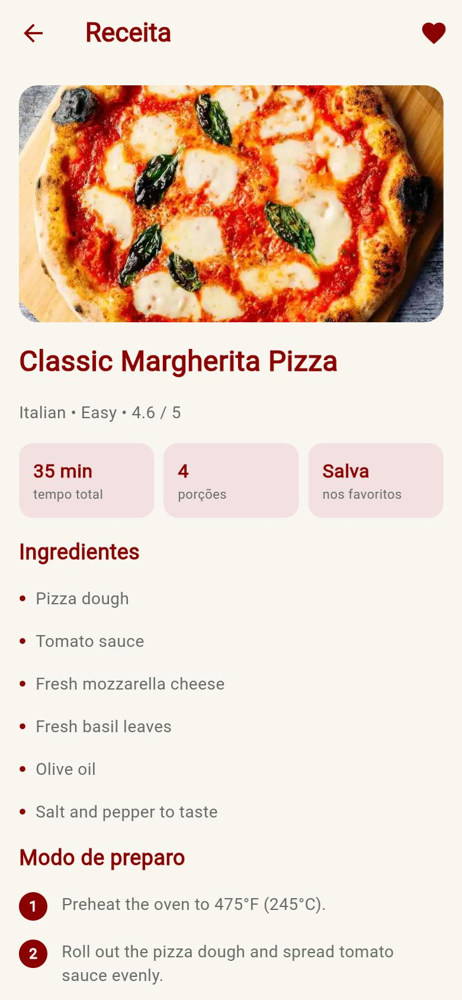
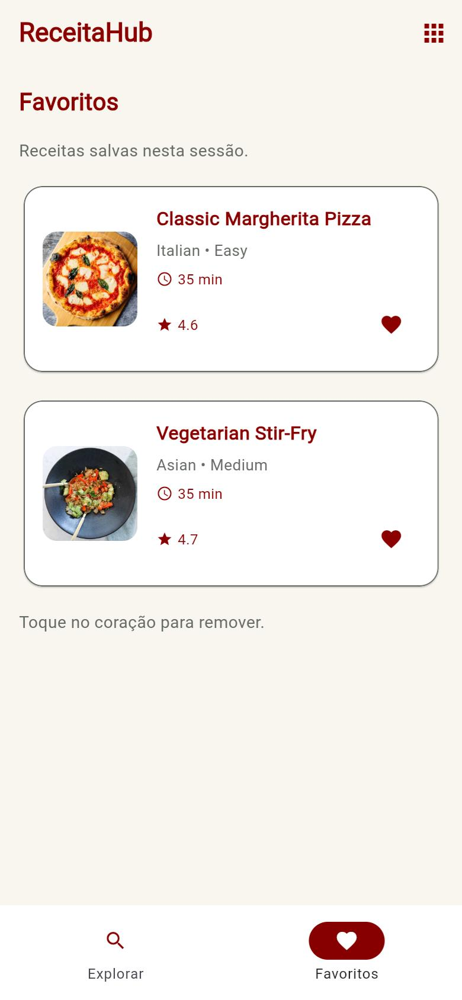
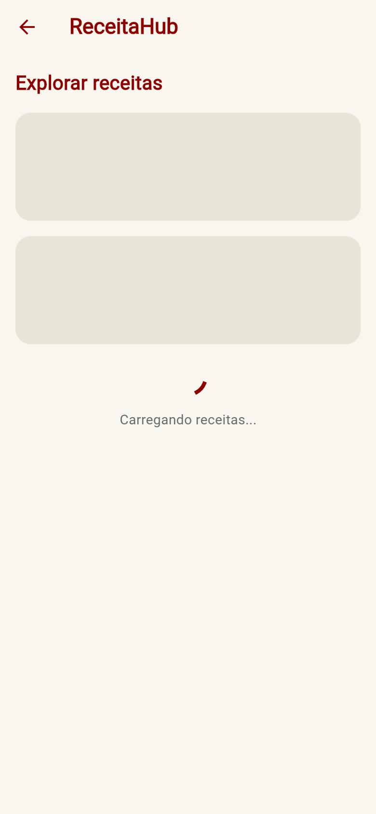
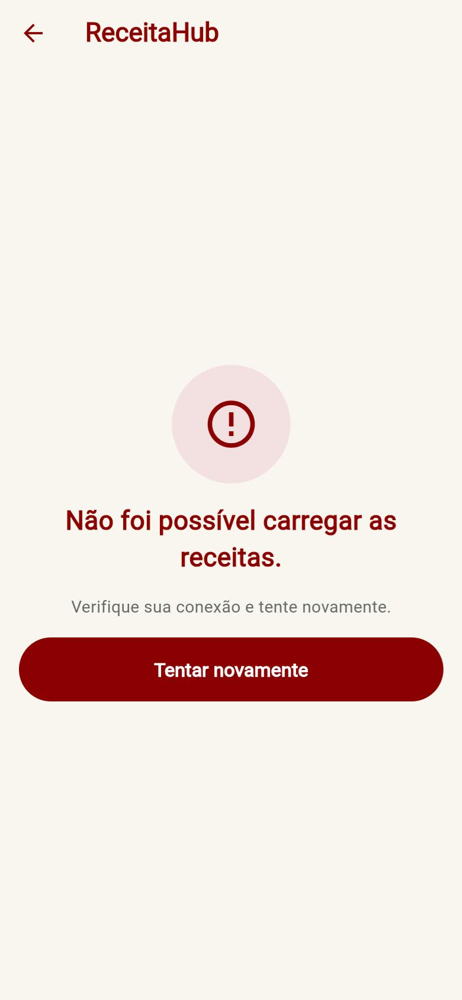
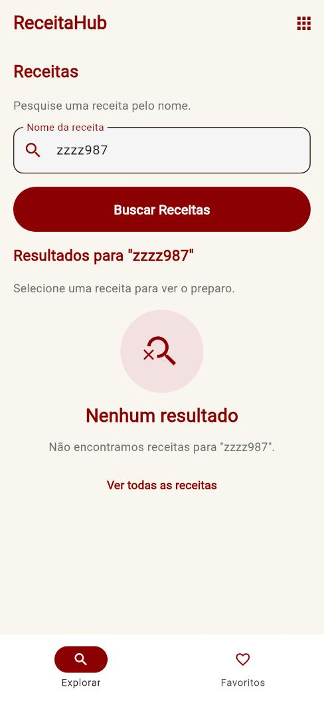
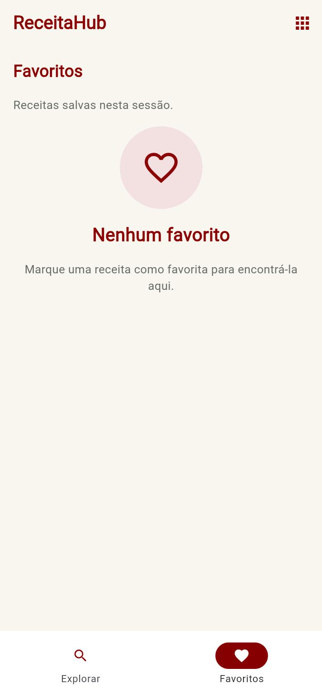
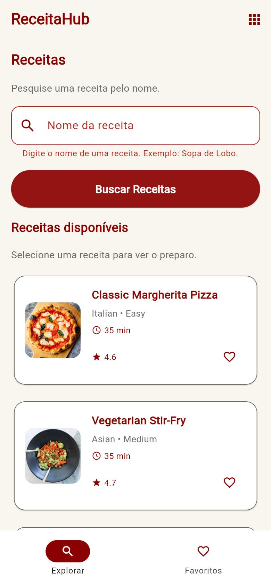

# ReceitaHub

## Descrição

O **ReceitaHub** é um aplicativo mobile de receitas feito em **Flutter**. Ele busca as receitas de uma API pública (a [DummyJSON](https://dummyjson.com/docs/recipes)), mostra cada uma em um card, deixa pesquisar pelo nome, abrir o detalhe com ingredientes e modo de preparo e salvar as favoritas.

> Projeto de estudo e portfólio. O layout foi baseado em um guia visual de 9 telas, reproduzido passo a passo.

## Telas

| Explorar | Pesquisar | Detalhe da receita |
| :---: | :---: | :---: |
|  |  |  |

| Favoritos | Carregando | Erro de conexão |
| :---: | :---: | :---: |
|  |  |  |

| Nenhum resultado | Nenhum favorito | Validação do campo |
| :---: | :---: | :---: |
|  |  |  |

## Funcionalidades

- [x] Lista de receitas vindas da API, em cards com foto, nome, cozinha, dificuldade, tempo total e nota
- [x] Tratamento da API: resposta com status diferente de 200, lista vazia e falta de conexão, cada um com uma mensagem e o botão "Tentar novamente"
- [x] Tela de carregando enquanto a API responde
- [x] Pesquisa por nome, com tratamento de espaços e mensagem que explica como corrigir quando o campo está vazio
- [x] Estado de "Nenhum resultado" e botão "Ver todas as receitas"
- [x] Detalhe da receita: foto, tempo total, porções, ingredientes e modo de preparo
- [x] Favoritar e desfavoritar receitas, pelo coração do card ou do detalhe
- [x] Aba Favoritos, com mensagem quando ainda não há nenhuma
- [x] Navegação por abas (Explorar e Favoritos) e entre telas
- [x] Menu com todas as telas (ícone de grade no topo), incluindo as telas de estado

### Limitações

- Os favoritos ficam só na memória: ao fechar o app, a lista volta a ficar vazia.
- A pesquisa filtra as receitas que já foram carregadas da API (30 por padrão).

## API

- Endereço usado: `https://dummyjson.com/recipes` (método `GET`)
- Documentação: <https://dummyjson.com/docs/recipes>
- A chamada fica em `lib/request.dart`. Ela devolve a lista de receitas ou uma mensagem de erro:

| Situação | Resultado |
| --- | --- |
| Status diferente de 200 | Mensagem com o código do erro |
| Status 200 com a lista vazia | "Nenhuma receita encontrada." |
| Sem internet ou resposta inválida | Mensagem de falha de conexão |

## SDK usado

| Item | Versão |
| --- | --- |
| Dart SDK | `^3.13.7` (definido no `pubspec.yaml`) |
| Flutter | 3.47.8, canal stable (versão usada no desenvolvimento) |

## Dependências

| Pacote | Versão | Para que serve |
| --- | --- | --- |
| [`http`](https://pub.dev/packages/http) | `^1.6.0` | Chamar a API de receitas |
| [`cupertino_icons`](https://pub.dev/packages/cupertino_icons) | `^1.0.8` | Pacote de ícones padrão do projeto Flutter |

Dependências de desenvolvimento:

| Pacote | Versão |
| --- | --- |
| `flutter_test` | do SDK do Flutter |
| [`flutter_lints`](https://pub.dev/packages/flutter_lints) | `^6.0.0` |

## Como executar

### Pré-requisitos

- [Flutter instalado](https://docs.flutter.dev/get-started/install) (Dart `3.13.7` ou mais novo). Confira com `flutter --version` e `flutter doctor`.
- Conexão com a internet, porque as receitas e as fotos vêm da API.
- Um destino para rodar: o navegador Chrome, um emulador Android ou um celular conectado.

### Passo a passo

```bash
git clone https://github.com/PedroAnt06/Flutter-ReceitaHub.git
cd Flutter-ReceitaHub
flutter pub get
flutter run
```

Para ver os destinos disponíveis e escolher um:

```bash
flutter devices
flutter run -d chrome
```

Para usar um emulador Android, inicie-o antes (`flutter emulators` lista os disponíveis) e rode `flutter run`.

No Chrome, a primeira abertura pode levar uns 10 a 15 segundos para o app aparecer.

## Estrutura

```
lib/
├── main.dart             # ponto de entrada (MaterialApp)
├── request.dart          # chamada à API e tratamento de erros
├── favoritos.dart        # lista de receitas favoritas
├── theme/
│   └── cores.dart        # cores do app
└── screens/
    ├── tela_principal.dart       # navbar e troca de abas
    ├── tela_inicial.dart         # Explorar: busca, pesquisa e cards
    ├── tela_favoritos.dart       # aba Favoritos
    ├── tela_detalhe.dart         # detalhe da receita
    ├── tela_menu.dart            # lista com todas as telas
    ├── tela_pesquisa.dart        # layout da tela de pesquisa
    ├── tela_validacao.dart       # layout do campo vazio com erro
    ├── tela_nenhum_resultado.dart
    ├── tela_nenhum_favorito.dart
    ├── tela_carregando.dart
    └── tela_erro.dart
docs/
└── screenshots/          # prints das telas usados neste README
```

## Aprendizados

Neste projeto aprendi a como organizar as telas utilizando widgets, entendendo também suas funcionalidades.

## Autor

**Pedro** — [GitHub](https://github.com/PedroAnt06)
